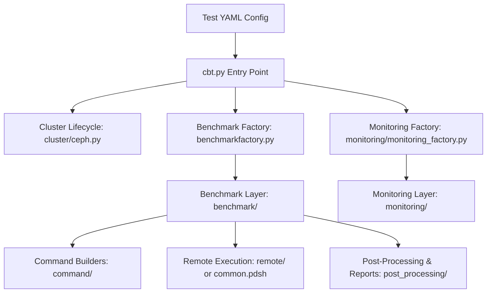

# CBT Architecture & Execution Contracts

This document outlines the core architectural boundaries, execution flows, and interface contracts across CBT (Ceph Benchmark Tool). Future refactors and new implementations must adhere to these contracts.

---

## 1. High-Level System Layering

CBT follows a modular architecture separating configuration, orchestration, command generation, remote execution, and monitoring:



### Layer Responsibilities
* **Orchestration (`cbt.py`)**: Parses CLI arguments and YAML test definitions, initializes the cluster and monitoring, and iterates through configured benchmark runs.
* **Factories (`benchmarkfactory.py`, `client_endpoints_factory.py`, `monitoring/monitoring_factory.py`)**: Instantiate concrete subsystem objects from configuration dictionaries.
* **Benchmark Layer (`benchmark/`)**: Implements benchmark-specific lifecycle, sweep permutations, and coordination. Contains no raw CLI string building.
* **Command Builders (`command/`)**: Dedicated classes inheriting from `Command` (`command/command.py`) that validate options and construct exact CLI invocation strings.
* **Monitoring Subsystem (`monitoring/`)**: Manages auxiliary performance metrics collectors (e.g. `collectl`, `perf`, `top`, `blktrace`, OSD PID monitoring) during benchmark runs.
* **Remote Execution**: Executes commands across remote nodes via `remote/` executors or `common.pdsh`.

---

## 2. Benchmark Subsystem & Lifecycle

### Invariants
1. **Single class per file**: Every file in `benchmark/` contains exactly one class (e.g. `radosbench.py` and `radosbench_analyzer.py` are distinct files).
2. **Hierarchy**:
   ```
   Benchmark (ABC)                     benchmark/benchmark.py
   ├── Nullbench                       benchmark/nullbench.py
   ├── Radosbench                      benchmark/radosbench.py
   ├── Hsbench                         benchmark/hsbench.py
   ├── Getput                          benchmark/getput.py
   ├── CephTestRados                   benchmark/cephtestrados.py
   ├── Elbencho                        benchmark/elbencho.py
   └── FioBenchmark (ABC)              benchmark/base_fio.py
       ├── Fio                         benchmark/fio.py
       ├── RbdFio                      benchmark/rbdfio.py
       ├── LibrbdFio                   benchmark/librbdfio.py
       ├── KvmRbdFio                   benchmark/kvmrbdfio.py
       └── RawFio                      benchmark/rawfio.py
   ```

### Execution Lifecycle
When `cbt.py` executes a benchmark, `Benchmark.run()` coordinates the following lifecycle:
1. `setup()`: Prepare local/remote state.
2. `setup_targets()`: Configure storage targets (e.g., pools, RBD images, filesystems).
3. Benchmark workload execution: Execute commands generated by `command/<name>_command.py`.
4. `analyze(out_dir)`: Parse output and extract metrics.
5. `cleanup_targets()`: Teardown benchmark-specific storage targets.
6. `cleanup()`: Clean up temporary files and reset environment.

---

## 3. Directory Layout & Output Contracts

Downstream post-processing tools and automated test frameworks rely on deterministic output paths:

* **`self.archive_dir`**: The root archive path specified in the test plan YAML.
* **`self.run_dir`**: The run directory for the active iteration and parameter sweep.
  - Formatted by `Benchmark.__init__` as `<archive_dir>/<benchmark_name>/<iteration>/osd_ra-<read_ahead>/...`.
  - **Path Invariant**: Subclasses must not prepend or append duplicate `/osd_ra-XXXXXXXX/` segments.
* **`self.out_dir`**: Output directory passed to `analyze()` (defaults to `self.archive_dir` in `Benchmark.__init__`).

---

## 4. Monitoring Subsystem & Template Placeholders

Monitoring tools are instantiated via `MonitoringFactory` and use customizable command templates configured in YAML or default profiles.

### Template Placeholder Contracts
Placeholders are evaluated at startup and must strictly match the supported set per monitor type:

| Monitor Class | Supported Placeholders | Error Behavior |
| :--- | :--- | :--- |
| `OsdPidMonitoring` / `OsdPerfMonitoring` | `{output_dir}`, `{pid}` | Raises `ValueError` naming any unsupported placeholder |
| `PerfMonitoring` | `{perf_dir}` | Raises `ValueError` naming any unsupported placeholder |
| `TopMonitoring` | `{top_dir}` | Raises `ValueError` naming any unsupported placeholder |

Pre-flight template formatting ensures that unknown or misspelled placeholders fail immediately with a descriptive `ValueError` before benchmark runs begin.
