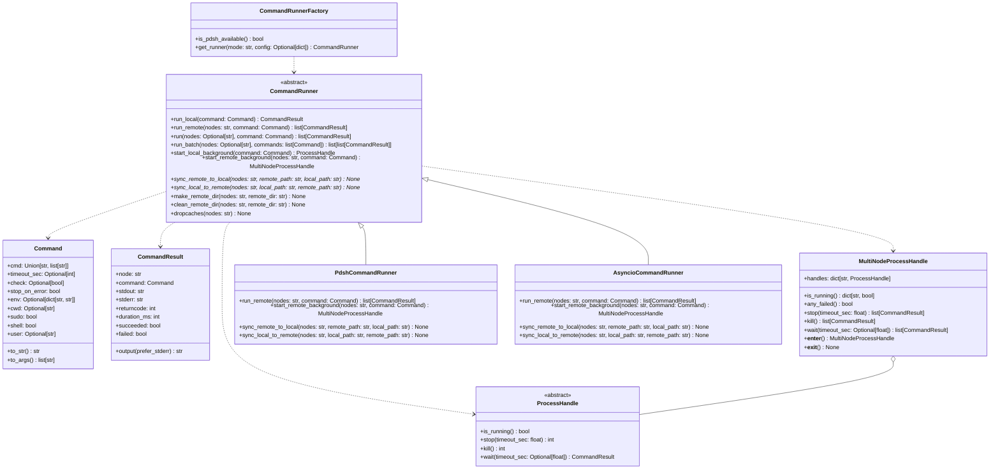

# CBT Command Runner Architecture & Design Specification

## 1. Executive Summary & Objectives

The Ceph Benchmark Tool (CBT) dispatches commands both locally on the coordinator system and remotely across heterogeneous Ceph cluster nodes (clients, OSDs, MONs, MGRs, MDSs, RGWs). Historically, remote execution relied exclusively on `pdsh` and subprocess wrappers (`common.pdsh()`, `CheckedPopen`). Recent efforts introduced an asynchronous SSH backend (`remote/async_ssh.py` via `RemoteExecutor`), creating duplicate execution pathways with inconsistent return types, error handling, and caller interfaces.

This document defines the unified **Command Execution Framework** for CBT.

### Core Objectives
1. **Unified Interface**: Provide a single abstract interface (`CommandRunner`) capable of executing local and remote commands without callers needing knowledge of the underlying transport (`pdsh` vs. `asyncio`/`ssh`).
2. **Dynamic Auto-Detection & Selection**: Automatically detect the availability of `pdsh` on the host system or allow explicit user override in configuration with fail-fast strict validation.
3. **Strong Object-Oriented Modeling**: Introduce immutable data models for commands (`Command`), structured per-node execution outcomes (`CommandResult`), and background process handles (`ProcessHandle`, `MultiNodeProcessHandle`).
4. **Consistent Error & Continuation Policy**: Standardize `continue_on_error` semantics across all runners, supporting both fail-fast exceptions (`CommandExecutionError`) and non-fatal warning modes.
5. **Robust Background Process Lifecycle**: Provide first-class background process handles supporting graceful termination (`stop()`), force-kill (`kill()`), status polling, and automatic cleanup via Python context managers.
6. **Observability & Logging**: Comply strictly with CBT's dual logging model (concise progress to CLI/screen, exhaustive debug output with timings, exit codes, and stdout/stderr to log files).
7. **Testability**: Enable straightforward unit testing and mocking across benchmarks, cluster orchestration, and monitoring tools without requiring live SSH or shell invocation.

---

## 2. Architecture & Class Hierarchy

The architecture adopts a **Unified Abstract Base Class** pattern. Callers (benchmarks, cluster managers, monitoring plugins) hold a single `CommandRunner` instance.



---

## 3. Data Models & Type Specifications

### 3.1 `Command` Specification

The `Command` class is an immutable value object defining execution attributes:

```python
from dataclasses import dataclass
from typing import Optional, Union
import shlex

@dataclass(frozen=True)
class Command:
    """Immutable specification for a command to execute locally or remotely."""
    cmd: Union[str, list[str]]
    """Command string (e.g. 'fio --name=test') or argument list."""

    timeout_sec: Optional[int] = None
    """Max execution duration in seconds. None indicates no timeout."""

    check: Optional[bool] = None
    """If True, raise CommandExecutionError on non-zero exit code.
    If None, falls back to CBT global 'continue_on_error' setting."""

    stop_on_error: bool = False
    """For batch execution: abort remaining commands if this command fails."""

    env: Optional[dict[str, str]] = None
    """Environment variables to pass to the process."""

    cwd: Optional[str] = None
    """Working directory for local execution."""

    sudo: bool = False
    """Prepend 'sudo' to the command execution."""

    shell: bool = False
    """Execute via shell interpreter (for pipes/redirection)."""

    user: Optional[str] = None
    """Target user override for remote execution (e.g., 'ubuntu@node')."""

    def to_str(self) -> str:
        """Render the command as a shell string."""
        base_cmd = self.cmd if isinstance(self.cmd, str) else " ".join(shlex.quote(str(x)) for x in self.cmd)
        if self.sudo and not base_cmd.strip().startswith("sudo"):
            return f"sudo {base_cmd}"
        return base_cmd

    def to_args(self) -> list[str]:
        """Render the command as an argument list for direct subprocess exec."""
        if isinstance(self.cmd, list):
            args = list(self.cmd)
        else:
            args = shlex.split(self.cmd)
        if self.sudo and (not args or args[0] != "sudo"):
            args.insert(0, "sudo")
        return args
```

### 3.2 `CommandResult` Specification

```python
@dataclass(frozen=True)
class CommandResult:
    """Immutable result of command execution on a single host."""
    node: str
    """Target hostname or 'localhost'."""

    command: Command
    """Reference to the Command specification executed."""

    stdout: str
    """Decoded standard output from the process."""

    stderr: str
    """Decoded standard error from the process."""

    returncode: int
    """Process exit status (0 = success)."""

    duration_ms: int
    """Wall-clock duration in milliseconds."""

    @property
    def succeeded(self) -> bool:
        """True if the returncode is 0."""
        return self.returncode == 0

    @property
    def failed(self) -> bool:
        """True if the returncode is non-zero."""
        return self.returncode != 0

    def output(self, prefer_stderr: bool = True) -> str:
        """Convenience method returning output text."""
        if prefer_stderr:
            return self.stderr if self.stderr.strip() else self.stdout
        return self.stdout if self.stdout.strip() else self.stderr
```

### 3.3 Exceptions

```python
class CommandRunnerException(Exception):
    """Base exception for all CommandRunner errors."""

class CommandRunnerConfigurationError(CommandRunnerException):
    """Raised when an explicit runner configuration cannot be satisfied (e.g. pdsh not found)."""

class CommandExecutionError(CommandRunnerException):
    """Raised when a command fails with check=True."""
    def __init__(self, failed_results: list[CommandResult], message: str = ""):
        self.failed_results = failed_results
        self.message = message
        failed_nodes = [r.node for r in failed_results]
        detail = (
            f"{message}\n"
            f"Failed on nodes: {', '.join(failed_nodes)}\n"
            f"First error detail ({failed_results[0].node}, exit {failed_results[0].returncode}):\n"
            f"{failed_results[0].output()}"
        )
        super().__init__(detail)

class CommandTimeoutError(CommandRunnerException):
    """Raised when command execution exceeds the specified timeout."""
```

---

## 4. Background Process Lifecycle Management

To prevent orphaned processes when runs are aborted or encounter unexpected exceptions, background processes use explicit handles with context manager integration.

### 4.1 `ProcessHandle` Abstract Class

```python
from abc import ABC, abstractmethod

class ProcessHandle(ABC):
    """Lifecycle handle for a single running process (local or remote)."""

    @abstractmethod
    def is_running(self) -> bool:
        """Check if the process is currently active."""

    @abstractmethod
    def stop(self, timeout_sec: float = 5.0) -> int:
        """Gracefully terminate the process (SIGINT/SIGTERM).
        Escalates to SIGKILL if timeout expires."""

    @abstractmethod
    def kill(self) -> int:
        """Forcefully terminate the process (SIGKILL)."""

    @abstractmethod
    def wait(self, timeout_sec: Optional[float] = None) -> CommandResult:
        """Wait for process completion and return the final CommandResult."""
```

### 4.2 `MultiNodeProcessHandle` Composite

```python
class MultiNodeProcessHandle:
    """Manages concurrent background processes across multiple cluster nodes."""

    def __init__(self, handles: dict[str, ProcessHandle]):
        self.handles = handles  # node_name -> ProcessHandle

    def is_running(self) -> dict[str, bool]:
        """Return running status for each node."""
        return {node: h.is_running() for node, h in self.handles.items()}

    def any_failed(self) -> bool:
        """True if any process terminated unexpectedly early."""
        return any(not h.is_running() for h in self.handles.values())

    def stop(self, timeout_sec: float = 5.0) -> list[CommandResult]:
        """Stop all background processes in parallel."""
        # Executes stop concurrently across all node handles
        ...

    def kill(self) -> list[CommandResult]:
        """Forcefully kill all background processes."""
        ...

    def wait(self, timeout_sec: Optional[float] = None) -> list[CommandResult]:
        """Wait for all processes to complete."""
        ...

    def __enter__(self) -> "MultiNodeProcessHandle":
        return self

    def __exit__(self, exc_type, exc_val, exc_tb) -> None:
        self.stop(timeout_sec=5.0)
```

---

## 5. The `CommandRunner` Abstract Base Class

The `CommandRunner` interface defines both local and remote dispatch, common cluster management helpers, and file synchronization.

```python
import logging
import os
import subprocess
import time
from abc import ABC, abstractmethod
from typing import Optional, Union
import settings
from common import expanded_node_list, get_localnode

logger = logging.getLogger("cbt")

class CommandRunner(ABC):
    """Abstract Base Class for all CBT command execution."""

    def __init__(self) -> None:
        self._default_continue_on_error = settings.common.get(
            "continue_on_error",
            settings.common.get("pdsh_continue_on_error", True)
        )

    # -------------------------------------------------------------------------
    # Core Synchronous Execution Methods
    # -------------------------------------------------------------------------

    def run(self, nodes: Optional[str], command: Command) -> list[CommandResult]:
        """Intelligent dispatch: routes to run_local if nodes is local/empty,
        otherwise delegates to run_remote."""
        if nodes is None or nodes == "" or nodes == "localhost" or get_localnode(nodes):
            local_node = get_localnode(nodes) or "localhost"
            return [self.run_local(command, node_name=local_node)]
        return self.run_remote(nodes, command)

    def run_local(self, command: Command, node_name: str = "localhost") -> CommandResult:
        """Execute a command locally on the coordinator system."""
        start_time = time.time()
        should_check = command.check if command.check is not None else (not self._default_continue_on_error)

        env = dict(os.environ)
        if command.env:
            env.update(command.env)
        env["LC_ALL"] = "C"

        cmd_repr = command.to_str()
        logger.debug("[Local] Executing: %s (cwd=%s, timeout=%s)", cmd_repr, command.cwd, command.timeout_sec)

        try:
            if command.shell:
                proc = subprocess.Popen(
                    cmd_repr,
                    shell=True,
                    stdout=subprocess.PIPE,
                    stderr=subprocess.PIPE,
                    cwd=command.cwd,
                    env=env,
                    preexec_fn=os.setsid,
                )
            else:
                proc = subprocess.Popen(
                    command.to_args(),
                    shell=False,
                    stdout=subprocess.PIPE,
                    stderr=subprocess.PIPE,
                    cwd=command.cwd,
                    env=env,
                    preexec_fn=os.setsid,
                )

            try:
                stdout_bytes, stderr_bytes = proc.communicate(timeout=command.timeout_sec)
            except subprocess.TimeoutExpired as exc:
                os.killpg(os.getpgid(proc.pid), 9)
                proc.communicate()
                raise CommandTimeoutError(f"Local command timed out after {command.timeout_sec}s: {cmd_repr}") from exc

            duration_ms = int((time.time() - start_time) * 1000)
            result = CommandResult(
                node=node_name,
                command=command,
                stdout=stdout_bytes.decode(errors="replace").strip(),
                stderr=stderr_bytes.decode(errors="replace").strip(),
                returncode=proc.returncode or 0,
                duration_ms=duration_ms,
            )

            self._log_result(result)

            if should_check and result.failed:
                raise CommandExecutionError([result], f"Local command failed with exit code {result.returncode}")

            return result

        except Exception as exc:
            if not isinstance(exc, CommandRunnerException):
                logger.error("[Local] Process execution failed: %s", exc)
            raise

    @abstractmethod
    def run_remote(self, nodes: str, command: Command) -> list[CommandResult]:
        """Execute a command across remote nodes. Implemented by subclasses."""

    # -------------------------------------------------------------------------
    # Batch Execution
    # -------------------------------------------------------------------------

    def run_batch(self, nodes: Optional[str], commands: list[Command]) -> list[list[CommandResult]]:
        """Run a sequence of commands on target nodes.
        If a command has stop_on_error=True and fails, execution aborts."""
        batch_results: list[list[CommandResult]] = []
        for cmd in commands:
            res = self.run(nodes, cmd)
            batch_results.append(res)
            if cmd.stop_on_error and any(r.failed for r in res):
                logger.warning("Aborting batch execution due to failure in command: %s", cmd.to_str())
                break
        return batch_results

    # -------------------------------------------------------------------------
    # Background Execution Methods
    # -------------------------------------------------------------------------

    def start_local_background(self, command: Command) -> ProcessHandle:
        """Start a local process in the background and return a handle."""
        ...

    @abstractmethod
    def start_remote_background(self, nodes: str, command: Command) -> MultiNodeProcessHandle:
        """Start background daemons on remote nodes."""

    # -------------------------------------------------------------------------
    # File Synchronization
    # -------------------------------------------------------------------------

    @abstractmethod
    def sync_remote_to_local(self, nodes: str, remote_path: str, local_path: str) -> None:
        """Pull remote files/directories from target nodes into local directory."""

    @abstractmethod
    def sync_local_to_remote(self, nodes: str, local_path: str, remote_path: str) -> None:
        """Push local files/directories to target nodes."""

    # -------------------------------------------------------------------------
    # Cluster Helpers
    # -------------------------------------------------------------------------

    def make_remote_dir(self, nodes: str, remote_dir: str) -> None:
        """Create directory on nodes with error checking."""
        cmd = Command(cmd=f"mkdir -p -m0755 -- {remote_dir}", check=True)
        self.run(nodes, cmd)

    def clean_remote_dir(self, nodes: str, remote_dir: str) -> None:
        """Safely remove directory on remote nodes."""
        if remote_dir in ("", "/", "/root", "/home"):
            raise ValueError(f"Unsafe directory path for deletion: {remote_dir}")
        cmd = Command(cmd=f"if [ -d '{remote_dir}' ]; then rm -rf '{remote_dir}'; fi", check=True)
        self.run(nodes, cmd)

    def dropcaches(self, nodes: str) -> None:
        """Sync and drop kernel caches on target nodes."""
        self.run(nodes, Command(cmd="sync", check=False))
        self.run(nodes, Command(cmd="echo 3 | sudo tee /proc/sys/vm/drop_caches", check=False))

    # -------------------------------------------------------------------------
    # Logging Helper
    # -------------------------------------------------------------------------

    def _log_result(self, result: CommandResult) -> None:
        if result.failed:
            logger.warning("[%s] Command FAILED (exit %d, %dms): %s",
                           result.node, result.returncode, result.duration_ms, result.output()[:300])
        else:
            logger.debug("[%s] Command SUCCESS (exit 0, %dms)", result.node, result.duration_ms)
        if result.stdout:
            logger.debug("[%s] stdout:\n%s", result.node, result.stdout)
        if result.stderr:
            logger.debug("[%s] stderr:\n%s", result.node, result.stderr)
```

---

## 6. Concrete Runner Implementations

### 6.1 `PdshCommandRunner`

Uses the `pdsh` binary for remote fanout and `pdcp`/`rpdcp` for file transfers:

```python
class PdshCommandRunner(CommandRunner):
    """pdsh-based remote execution backend."""

    def __init__(self, pdsh_cmd: str = "pdsh", pdsh_ssh_args: Optional[str] = None):
        super().__init__()
        self.pdsh_cmd = pdsh_cmd
        self.pdsh_ssh_args = pdsh_ssh_args or settings.common.get("pdsh_ssh_args")

    def run_remote(self, nodes: str, command: Command) -> list[CommandResult]:
        node_list = expanded_node_list(nodes)
        should_check = command.check if command.check is not None else (not self._default_continue_on_error)
        
        args = [
            self.pdsh_cmd,
            "-f", str(len(node_list)),
            "-R", "ssh",
            "-w", nodes,
            command.to_str()
        ]
        
        # -S: fail if any host fails
        if should_check:
            args.insert(1, "-S")

        env = dict(os.environ)
        if self.pdsh_ssh_args:
            env["PDSH_SSH_ARGS"] = self.pdsh_ssh_args
        env["LC_ALL"] = "C"

        start_time = time.time()
        logger.debug("[pdsh] Executing on %d nodes: %s", len(node_list), command.to_str())

        proc = subprocess.Popen(
            args,
            stdout=subprocess.PIPE,
            stderr=subprocess.PIPE,
            env=env,
            preexec_fn=os.setsid,
        )

        try:
            stdout_bytes, stderr_bytes = proc.communicate(timeout=command.timeout_sec)
        except subprocess.TimeoutExpired as exc:
            os.killpg(os.getpgid(proc.pid), 9)
            proc.communicate()
            raise CommandTimeoutError(f"pdsh timed out after {command.timeout_sec}s") from exc

        duration_ms = int((time.time() - start_time) * 1000)
        results = self._parse_pdsh_output(node_list, command, stdout_bytes.decode(errors="replace"),
                                          stderr_bytes.decode(errors="replace"), proc.returncode, duration_ms)

        for res in results:
            self._log_result(res)

        if should_check and any(r.failed for r in results):
            failed = [r for r in results if r.failed]
            raise CommandExecutionError(failed, f"pdsh execution failed across {len(failed)} node(s)")

        return results

    def _parse_pdsh_output(self, node_list: list[str], command: Command,
                            stdout: str, stderr: str, returncode: int, duration_ms: int) -> list[CommandResult]:
        node_stdout: dict[str, list[str]] = {n: [] for n in node_list}
        node_stderr: dict[str, list[str]] = {n: [] for n in node_list}

        for line in stdout.splitlines():
            if ":" in line:
                host, _, content = line.partition(":")
                host = host.strip()
                if host in node_stdout:
                    node_stdout[host].append(content.lstrip())

        for line in stderr.splitlines():
            if ":" in line:
                host, _, content = line.partition(":")
                host = host.strip()
                if host in node_stderr:
                    node_stderr[host].append(content.lstrip())

        return [
            CommandResult(
                node=node,
                command=command,
                stdout="\n".join(node_stdout[node]),
                stderr="\n".join(node_stderr[node]),
                returncode=returncode,
                duration_ms=duration_ms,
            )
            for node in node_list
        ]

    def start_remote_background(self, nodes: str, command: Command) -> MultiNodeProcessHandle:
        ...

    def sync_remote_to_local(self, nodes: str, remote_path: str, local_path: str) -> None:
        # Implemented via rpdcp
        ...

    def sync_local_to_remote(self, nodes: str, local_path: str, remote_path: str) -> None:
        # Implemented via pdcp
        ...
```

### 6.2 `AsyncioCommandRunner`

Uses Python's `asyncio` subprocess framework and OpenSSH:

```python
import asyncio

class AsyncioCommandRunner(CommandRunner):
    """AsyncIO/SSH remote execution backend."""

    def __init__(self, user: Optional[str] = None):
        super().__init__()
        self.user = user or settings.cluster.get("user")

    def run_remote(self, nodes: str, command: Command) -> list[CommandResult]:
        node_list = expanded_node_list(nodes)
        should_check = command.check if command.check is not None else (not self._default_continue_on_error)

        logger.debug("[AsyncSSH] Executing across %d nodes: %s", len(node_list), command.to_str())
        results = asyncio.run(self._run_all(node_list, command))

        for res in results:
            self._log_result(res)

        if should_check and any(r.failed for r in results):
            failed = [r for r in results if r.failed]
            raise CommandExecutionError(failed, f"AsyncSSH execution failed on {len(failed)} node(s)")

        return results

    async def _run_all(self, node_list: list[str], command: Command) -> list[CommandResult]:
        tasks = [self._run_one(node, command) for node in node_list]
        return await asyncio.gather(*tasks)

    async def _run_one(self, node: str, command: Command) -> CommandResult:
        start_time = time.time()
        ssh_args = ["ssh", "-o", "BatchMode=yes", "-o", "StrictHostKeyChecking=no", "-o", "ConnectTimeout=10"]
        target_user = command.user or self.user
        if target_user:
            ssh_args.extend(["-l", str(target_user)])

        ssh_args.extend([node, command.to_str()])

        proc = await asyncio.create_subprocess_exec(
            *ssh_args,
            stdout=asyncio.subprocess.PIPE,
            stderr=asyncio.subprocess.PIPE,
        )

        try:
            stdout_bytes, stderr_bytes = await asyncio.wait_for(
                proc.communicate(),
                timeout=command.timeout_sec
            )
        except asyncio.TimeoutError as exc:
            proc.kill()
            await proc.wait()
            raise CommandTimeoutError(f"SSH to {node} timed out after {command.timeout_sec}s") from exc

        duration_ms = int((time.time() - start_time) * 1000)
        return CommandResult(
            node=node,
            command=command,
            stdout=stdout_bytes.decode(errors="replace").strip(),
            stderr=stderr_bytes.decode(errors="replace").strip(),
            returncode=proc.returncode if proc.returncode is not None else -1,
            duration_ms=duration_ms,
        )

    def start_remote_background(self, nodes: str, command: Command) -> MultiNodeProcessHandle:
        ...

    def sync_remote_to_local(self, nodes: str, remote_path: str, local_path: str) -> None:
        # Parallel scp -r pull
        ...

    def sync_local_to_remote(self, nodes: str, local_path: str, remote_path: str) -> None:
        # Parallel scp -r push
        ...
```

---

## 7. Configuration, Auto-Detection & Factory

### 7.1 Auto-Detection Flow & Precedence

1. **Explicit Setting**: If `settings.common.get("remote_executor")` (or `"command_runner"`) is explicitly set:
   - `"pdsh"`: Verify `pdsh` binary exists. If missing $\rightarrow$ **fail fast** by raising `CommandRunnerConfigurationError`.
   - `"asyncio"`: Instantiate `AsyncioCommandRunner`.
2. **Auto Mode (`"auto"` or unset)**:
   - Check if explicit `pdsh_cmd` path from config exists and is executable.
   - If not set or not found, check `shutil.which("pdsh")`.
   - If `pdsh` is found $\rightarrow$ select `PdshCommandRunner`.
   - If `pdsh` is NOT found $\rightarrow$ select `AsyncioCommandRunner`.

### 7.2 `CommandRunnerFactory` Implementation

```python
import shutil

class CommandRunnerFactory:
    """Factory for discovering and instantiating the appropriate CommandRunner."""

    @classmethod
    def is_pdsh_available(cls) -> bool:
        pdsh_cmd = settings.common.get("pdsh_cmd")
        if pdsh_cmd and (os.path.isabs(pdsh_cmd) and os.path.isfile(pdsh_cmd) and os.access(pdsh_cmd, os.X_OK)):
            return True
        binary = pdsh_cmd if pdsh_cmd else "pdsh"
        return shutil.which(binary) is not None

    @classmethod
    def get_runner(cls, mode: Optional[str] = None) -> CommandRunner:
        if mode is None:
            mode = settings.common.get("remote_executor", settings.common.get("command_runner", "auto"))

        mode = mode.lower()
        logger.info("Initializing CommandRunner (mode=%s)...", mode)

        if mode == "pdsh":
            if not cls.is_pdsh_available():
                pdsh_cmd = settings.common.get("pdsh_cmd", "pdsh")
                raise CommandRunnerConfigurationError(
                    f"pdsh runner was explicitly requested, but '{pdsh_cmd}' was not found on PATH or filesystem."
                )
            return PdshCommandRunner(
                pdsh_cmd=settings.common.get("pdsh_cmd", "pdsh"),
                pdsh_ssh_args=settings.common.get("pdsh_ssh_args")
            )

        if mode == "asyncio":
            return AsyncioCommandRunner(user=settings.cluster.get("user"))

        if mode == "auto":
            if cls.is_pdsh_available():
                logger.info("Auto-detected pdsh on host; selecting PdshCommandRunner.")
                return PdshCommandRunner(
                    pdsh_cmd=settings.common.get("pdsh_cmd", "pdsh"),
                    pdsh_ssh_args=settings.common.get("pdsh_ssh_args")
                )
            logger.info("pdsh not found on host; selecting AsyncioCommandRunner.")
            return AsyncioCommandRunner(user=settings.cluster.get("user"))

        raise CommandRunnerConfigurationError(f"Unknown command runner mode: '{mode}'")
```

---

## 8. Migration Plan & Integration Examples

### 8.1 Example: Refactoring Benchmark Execution (`benchmark/fio.py`)

**Before:**
```python
# Legacy fio.py
p = common.pdsh(settings.getnodes("clients"), self.run_command(i))
p.wait()
```

**After:**
```python
# Modern fio.py with CommandRunner
class Fio(Benchmark):
    def __init__(self, archive_dir, cluster, config):
        super().__init__(archive_dir, cluster, config)
        self.runner = CommandRunnerFactory.get_runner()

    def run(self):
        clients = settings.getnodes("clients")
        for i in range(self.endpoints_per_client):
            cmd = Command(
                cmd=self.run_command(i),
                timeout_sec=self.time + 120,
                check=True
            )
            self.runner.run(clients, cmd)
```

### 8.2 Example: Monitoring Tool Lifecycle with Context Manager

```python
class CollectlMonitoring(Monitoring):
    def __init__(self, nodes: str, runner: CommandRunner):
        self.nodes = nodes
        self.runner = runner
        self._daemon_handle: Optional[MultiNodeProcessHandle] = None

    def start(self, output_dir: str):
        cmd = Command(cmd=f"collectl -D -sD -f {output_dir}/collectl")
        self._daemon_handle = self.runner.start_remote_background(self.nodes, cmd)

    def stop(self):
        if self._daemon_handle:
            self._daemon_handle.stop(timeout_sec=5.0)
            self._daemon_handle = None
```

---

## 9. Testing & Mocking Strategy

The clean interface allows unit testing without spawning real subprocesses or making network calls:

```python
def test_benchmark_executes_expected_command():
    mock_runner = MagicMock(spec=CommandRunner)
    mock_runner.run.return_value = [
        CommandResult(node="client1", command=MagicMock(), stdout="OK", stderr="", returncode=0, duration_ms=100)
    ]

    fio = Fio(archive_dir="/tmp", cluster=None, config={})
    fio.runner = mock_runner
    fio.prefill()

    assert mock_runner.run.called
    cmd_arg = mock_runner.run.call_args[0][1]
    assert "--name=prefill" in cmd_arg.to_str()
```

---

## 10. Summary Matrix

| Feature | Legacy `common.pdsh` | Legacy `AsyncSSHExecutor` | New Unified `CommandRunner` |
|---|---|---|---|
| **Local Dispatch** | `common.sh()` (`CheckedPopenLocal`) | None | `runner.run_local()` / auto-routing |
| **Remote Dispatch** | `pdsh` subprocess | `asyncio` SSH | Pluggable `Pdsh` or `Asyncio` |
| **Result Type** | `CheckedPopen` | `list[tuple[...]]` | `list[CommandResult]` (Rich object) |
| **Error Handling** | Raises generic `Exception` | Raises `RuntimeError` | Custom `CommandExecutionError` |
| **Timeout Support** | None | None | Per-command `timeout_sec` |
| **Background Handles** | Manual `communicate()` omission | None | `ProcessHandle` / `MultiNodeProcessHandle` |
| **Auto-Detection** | None | None | Strict auto-detection via Factory |
| **File Sync** | `pdcp` / `rpdcp` | `scp -r` | `sync_remote_to_local` / `sync_local_to_remote` |
| **Logging** | Scattered | Basic debug | Dual-handler structured logging |
